<a href="./assets/header-en-dark.svg#gh-dark-mode-only"><picture>
  <source media="(max-width: 480px)" srcset="./assets/header-en-dark-mobile.svg">
  <source media="(max-width: 800px)" srcset="./assets/header-en-dark-tablet.svg">
  
</picture></a>
<a href="./assets/header-en-light.svg#gh-light-mode-only"><picture>
  <source media="(max-width: 480px)" srcset="./assets/header-en-light-mobile.svg">
  <source media="(max-width: 800px)" srcset="./assets/header-en-light-tablet.svg">
  
</picture></a>

I build web and mobile products, integrate AI into real workflows, and automate the work around them.

<a href="https://reymundotenorio.github.io/en/"><strong>Explore my portfolio ↗</strong></a> &nbsp;&middot;&nbsp; <a href="https://www.linkedin.com/in/reymundotenorio/">LinkedIn</a>

<code>TypeScript</code> &middot; <code>React</code> &middot; <code>React Native</code> &middot; <code>Node.js</code> &middot; <code>PHP</code> &middot; <code>WordPress</code> &middot; <code>Go</code>

<a href="./assets/activity-en-dark.svg#gh-dark-mode-only"><picture>
  <source media="(max-width: 480px)" srcset="./assets/activity-en-dark-mobile.svg">
  <source media="(max-width: 800px)" srcset="./assets/activity-en-dark-tablet.svg">
  
</picture></a>
<a href="./assets/activity-en-light.svg#gh-light-mode-only"><picture>
  <source media="(max-width: 480px)" srcset="./assets/activity-en-light-mobile.svg">
  <source media="(max-width: 800px)" srcset="./assets/activity-en-light-tablet.svg">
  
</picture></a>

<a href="./assets/languages-en-dark.svg#gh-dark-mode-only"><picture>
  <source media="(max-width: 480px)" srcset="./assets/languages-en-dark-mobile.svg">
  <source media="(max-width: 800px)" srcset="./assets/languages-en-dark-tablet.svg">
  
</picture></a>
<a href="./assets/languages-en-light.svg#gh-light-mode-only"><picture>
  <source media="(max-width: 480px)" srcset="./assets/languages-en-light-mobile.svg">
  <source media="(max-width: 800px)" srcset="./assets/languages-en-light-tablet.svg">
  
</picture></a>

About these numbers

All-time PR totals and yearly contribution history include personal and organization activity available to the GitHub API. Reviewed PRs are distinct pull requests reviewed, excluding my own. Contributions are not a commit count.

The language mix measures code bytes in owned non-fork repositories and repositories GitHub identifies as recently contributed to. It is not a measure of skill or personal authorship.

Snapshot: Nov 5, 2026. Visual direction inspired by <a href="https://github.com/stats-organization/github-stats-extended">GitHub Stats Extended</a>.

